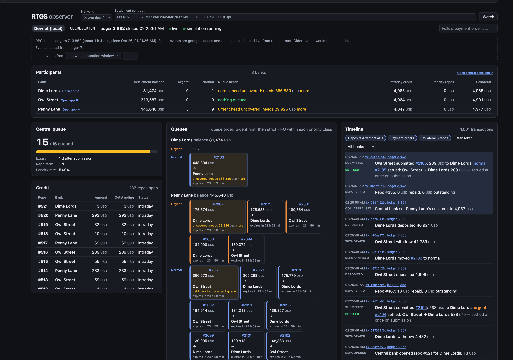
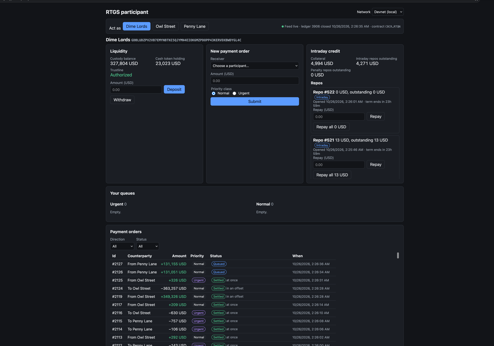
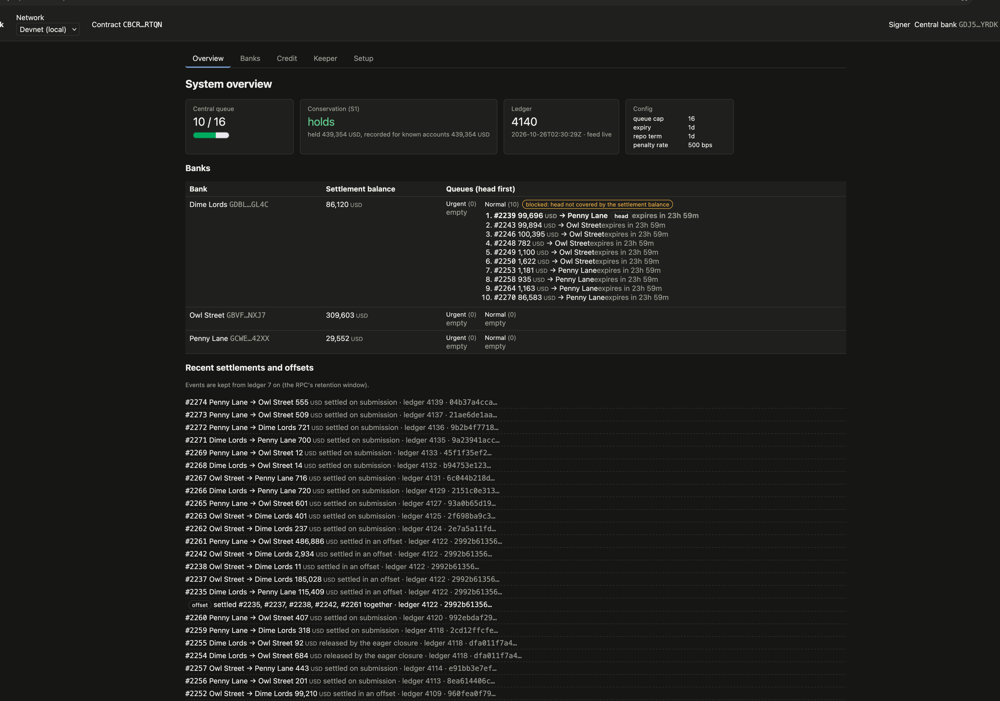

# stellar-rtgs

A Real-Time Gross Settlement (RTGS) system on Stellar. Banks hold settlement balances in one Soroban contract and pay each other with final, gross settlement. A payment order that the balance can't cover waits in an urgent or normal queue. The liquidity-saving offset clears gridlocked queues in a single step. The central bank lends intraday credit (repos) against collateral. The contract checks at every step that money is conserved. Its rules were modelled and checked in Quint before any contract code was written.

## Live on the Stellar testnet

The system is already deployed on the public Stellar testnet. A simulator keeps three banks (Dime Lords, Owl Street, Penny Lane) depositing, paying each other, queueing and taking repos around the clock.

**Site: <TODO: https://SITE_HOST>**

| App | Path | What it shows |
|---|---|---|
| Observer | `/` | Read-only view of the whole system: timeline of contract events, participants, queues, credit, liquidity flows |
| Central bank | `/central-bank/` | Operator and settlement agent: overview, banks, credit, keeper, setup |
| Participant | `/participant/?bank=1` | A bank: liquidity, payment orders, queues, intraday credit |

The apps open on the testnet, and each app's network selector switches to the hosted devnet. The apps sign with demo keys built into the page, so no wallet is needed. Anyone who opens them can act as the central bank or a bank, with test funds only. The hosting is described in [deploy/hetzner](deploy/hetzner/README.md).

### Contract instances (testnet)

| Instance | Address |
|---|---|
| Settlement contract | `<TODO: C…>`: [stellar.expert](https://stellar.expert/explorer/testnet/contract/TODO) |
| Cash token (USD, Stellar Asset Contract) | `<TODO: C…>`: [stellar.expert](https://stellar.expert/explorer/testnet/contract/TODO) |
| Central bank account (cash token issuer) | `<TODO: G…>`: [stellar.expert](https://stellar.expert/explorer/testnet/account/TODO) |

SDF resets the testnet every few months. After a reset the simulator deploys a new contract under the same central bank, so the contract ids above can change. The apps find the current contract through the central bank's account.

### Screenshots

**Observer.** The timeline of contract events, each bank's balance and queue heads, the central queue against its cap, and the open repos.



**Participant.** Acting as Dime Lords: liquidity, a new payment order, intraday credit and repos, the bank's queues and its payment orders, each with how it settled (at once or in an offset).



**Central bank.** The system overview: the central queue, the conservation check (S1), each bank's queues head first, and recent settlements and offsets.



## Repository

- `backend-soroban/`: the Soroban settlement contract, its tests and the local devnet.
- `frontend-web/`: the React apps (central bank, participant, observer) on a shared core package, and a headless simulator.

Each folder has its own README: [backend-soroban](backend-soroban/README.md), [frontend-web](frontend-web/README.md).

## Requirements

Everything installs from rustup, crates.io, npm and Docker Hub.

### Backend: compile and test

Needed for `make lint test build` in `backend-soroban/`.

| Tool | Version | How to get it |
|---|---|---|
| rustup | any recent | https://rustup.rs |
| Rust, with `wasm32v1-none`, rustfmt and clippy | 1.99.1 | Nothing to do: rustup reads `backend-soroban/rust-toolchain.toml` and installs it on the first `cargo` or `make` run in that folder |
| stellar-cli | 28.1.0 | `cargo install --locked stellar-cli@28.1.0`. `make build` runs `stellar contract build`, and `make test` builds first |
| make, bash | any | Shipped with macOS and Linux |

soroban-sdk is pinned at `=29.0.1` in `Cargo.toml`; cargo fetches it.

### Backend: the devnet

Needed for `make devnet-up`, `devnet-smoke` and `integration`, and for everything in the frontend that touches the network.

| Tool | Version | Notes |
|---|---|---|
| Docker | any recent, daemon running | The devnet is one `stellar/quickstart:v678-b1525.1-latest` container (protocol 29). The first `devnet-up` pulls the image; `docker pull stellar/quickstart:v678-b1525.1-latest` does it ahead of time |
| `jq`, `curl` | any | The devnet scripts use them to poll RPC and friendbot |
| A free port 8300 | | RPC is served on `http://localhost:8300/rpc`. `IMPL_NAME` and `IMPL_PORT` pick another container name and port |

`devnet-smoke` and `integration` also need the compile requirements above, since they build and deploy the contract.

### Backend: optional test layers

| Tool | Version | For |
|---|---|---|
| Node and npm, then quint | quint 0.33.0: `npm install --global @informalsystems/quint@0.33.0` | `make quint` (the model and its traces; also needs `jq`) |
| cargo-llvm-cov | 0.9.1: `cargo install --locked cargo-llvm-cov@0.9.1` | `make cov` |

The later layers (cargo-mutants, Kani, cargo-fuzz, scout) are described in [backend-soroban/TESTING.md](backend-soroban/TESTING.md).

### Frontend

| Tool | Version | How to get it |
|---|---|---|
| Node | 26 or later | https://nodejs.org |
| corepack, then pnpm | pnpm 11.28.5, pinned in `frontend-web/package.json` | `npm install -g corepack && corepack enable`. Node 26 no longer bundles corepack. corepack then fetches the pinned pnpm the first time `pnpm` runs in `frontend-web/` |
| The devnet's requirements | see above | Docker, `jq`, `curl`, for the bootstrap, the simulator, the apps on the devnet and `pnpm test:e2e` |

The frontend needs neither Rust nor stellar-cli: the contract's Wasm and its generated client are committed in `frontend-web/packages/core/`. Only regenerating them needs those tools: `pnpm bindings` needs stellar-cli 28.1.0, and `pnpm bindings --build` the backend's Rust toolchain too.

### Check your setup

```sh
(cd backend-soroban && rustc --version)   # rustc 1.99.1 (rustup installs it on first run)
stellar --version                         # first line: stellar 28.1.0
docker info --format '{{.ServerVersion}}' # prints a version: the daemon is running
jq --version
curl --version | head -1
node --version                            # v26 or later
(cd frontend-web && pnpm --version)       # 11.28.5
```

## Run it locally

To run it yourself instead of using the testnet deployment: start the devnet, watch it in the observer, and keep it busy with the simulator. You need the [devnet](#backend-the-devnet) and [frontend](#frontend) requirements; Rust and stellar-cli are not needed. Every command starts from the repository root, and the whole run takes about 2 minutes after the first image pull.

**1. Start the devnet.** In a terminal:

```sh
make -C backend-soroban devnet-up
```

It starts a container named `impl-local` and waits until RPC, protocol 29 and friendbot answer. It's done when it prints `up: http://localhost:8300/rpc`, about 20 s after the image is pulled.

**2. Install the frontend.**

```sh
cd frontend-web
npm install -g corepack && corepack enable   # skip if `pnpm --version` already prints 11.28.5
pnpm install
```

**3. Deploy on the devnet.** Still in `frontend-web/`:

```sh
pnpm devnet:bootstrap
```

It deploys the cash token and the settlement contract, onboards 3 funded banks, and prints the deployment as JSON (about 30 s). It also publishes the contract id on the central bank's account, which is how the apps find it.

**4. Open the observer.** Still in `frontend-web/`:

```sh
pnpm dev:observer
```

Open http://localhost:5176. There is no login and no wallet: the observer is read-only and signs nothing. It opens on the devnet and finds the contract by itself, so there is nothing to type or select. You see the **Timeline** of contract events, the **Participants** with their balances, the **Central queue**, each bank's **Queues** and the **Liquidity flows**. Leave this terminal running.

**5. Run the simulation.** In a second terminal, from the repository root:

```sh
cd frontend-web
pnpm simulate
```

The banks start depositing, paying each other, queueing, and taking and repaying repos. It runs until Ctrl-C. Each action prints one line: the bank, what it tried, then `→ ok` with the transaction hash and what followed (for example `→ ok 55b630cd queued #0 (2051 ms)`), `→ refused`, or `→ FAILED`. A healthy run has almost no `FAILED`. The usual one is `State changed`, a race between banks that the simulator gives up on after retrying it up to five times. Every 30 s a summary shows the queue, each bank's balances, the repos and the conservation check. When it stops, it prints the count of each action and its outcome. The observer's timeline fills live.

Useful flags:
- `--profile gridlock` shows the queues and the LSM offset at work.
- `--duration 60` stops by itself after 60 s.
- `--rate 1` slows it down. The default asks for 2 actions a second, but each transaction takes a few seconds on the devnet, so it usually manages 1 to 1.5.

Every flag is in [frontend-web/apps/simulator/README.md](frontend-web/apps/simulator/README.md).

**6. Optional: all three apps.** Stop the observer (Ctrl-C) and run `pnpm dev` in `frontend-web/` instead:

| App | URL |
|---|---|
| Central bank | http://localhost:5174 |
| Participant, as Dime Lords (bank 1) | http://localhost:5175/?bank=1 |
| Observer | http://localhost:5176 |

On the devnet the apps sign with demo keys derived from a public seed, so they need no wallet either.

**7. Stop.**

1. Ctrl-C the simulator once and wait for its summary. It finishes the transactions in flight and undoes anything half done; a second Ctrl-C exits at once.
2. Ctrl-C the dev server.
3. Remove the devnet, from the repository root: `make -C backend-soroban devnet-down`.

The devnet keeps no state: after the next `devnet-up`, run step 3 again.

### If something goes wrong

| Symptom | Fix |
|---|---|
| `container impl-local exists; run devnet/down.sh first` | A devnet is already up. Use it and go on to step 3, or `make -C backend-soroban devnet-down` first |
| Port 8300 is taken, or someone else's devnet runs on it | Start your own on another port, and point the frontend at it: `IMPL_NAME=impl-mine IMPL_PORT=8400 make -C backend-soroban devnet-up`, then `pnpm devnet:bootstrap --rpc http://localhost:8400/rpc`, `echo 'VITE_RTGS_DEVNET_RPC_URL=http://localhost:8400/rpc' >> .env` (in `frontend-web/`, before `pnpm dev:observer`), and `pnpm simulate --rpc http://localhost:8400/rpc`. Remove it with `docker rm -f impl-mine` |
| The observer finds no contract | Nothing is deployed on this devnet, usually after a restart. Run step 3, then reload the page |
| `pnpm` isn't found, or is the wrong version | `npm install -g corepack && corepack enable`, then run `pnpm` from `frontend-web/` |
| A dev server port is taken | Vite takes the next free port and prints it |

## Running the checks

```sh
make -C backend-soroban lint test build   # backend: fmt + clippy, unit tests, Wasm build
cd frontend-web && pnpm typecheck && pnpm test   # frontend: types, unit and component tests
```

The devnet tests are `make -C backend-soroban devnet-smoke integration` and, in `frontend-web/`, `pnpm test:e2e`, each against a running devnet. The subfolder READMEs cover the rest.
